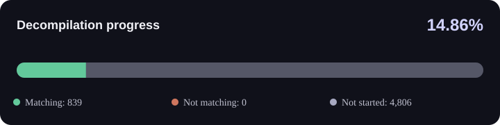

I genuinely believe this game deserves to be preserved and to shine new light again someday. Through this decompilation project, I hope to contribute to its preservation and help pave the way for a future PC port.

YES, this project uses AI. However, so far, I've only used the free tier of GitHub Copilot to help set up the decompilation environment and handle the currently matching functions that you see.

I have no personal plans to expand this work using other AI subscription services, as I don't really use any of them. I'll continue using free AI models and tools when available and manually decompile and match functions myself using Ghidra whenever I have the time.

Contributions are always welcome, in any form!

----

# Rayman Revolution (PAL) decompilation project

<!-- BEGIN GENERATED PROGRESS -->


**14.86% complete** (839 / 5,645 functions). **Matching:** 839 · **Not matching:** 0 · **Not started:** 4,806.
<!-- END GENERATED PROGRESS -->

This project is a work-in-progress matching decompilation of the PAL PlayStation 2 main executable, `SLES_500.44`. It uses generated MIPS disassembly as a reference while replacing functions with C or hand-written assembly. The build links an ELF at the original addresses so its file-backed main image can be compared byte-for-byte with the reference executable.

This repository contains project code and tooling only. It does not provide the game executable, disc image, extracted game assets, or the proprietary SN Systems toolchain. Generated disassembly and asset files are local inputs and are not intended for commit.

## Legal

- This project aims to produce source implementations whose compiled code matches the original game, as a preservation effort.
- This repository distributes project tooling and matched source code only. It does not include the game, a playable build, the retail executable, disc images, extracted assets, or other game files.
- Only use game files and development tools that you are authorized to possess and use under applicable law and their licenses. Do not commit or share game files, extracted content, or proprietary SDK files.

## Requirements

- Windows for the supported SN Systems ProDG PS2 EE toolchain.
- Python 3 and the Windows `py` launcher.
- A legally obtained SN Systems ProDG PS2 SDK whose EE GCC compiler and linker are named `ee-gcc.exe` and `ee-ld.exe`.
- An authorized PAL `SLES_500.44` executable that matches the version checked by the setup script.
- Optionally, Ghidra for interactive disassembly and analysis. It is not required by the build scripts; keep its distribution local and out of Git.

The Python dependencies are listed in `requirements.txt`; the disassembly-tool versions are checked by the setup script. Keep the SDK and game files local; neither is installed by the Python setup.

## Initial setup

Run the following commands in PowerShell from the project root.

1. Create a local Python environment and install the project dependencies:

   ```powershell
   py -3 -m venv .venv
   .\.venv\Scripts\python.exe -m pip install --upgrade pip
   .\.venv\Scripts\python.exe -m pip install -r requirements.txt
   ```

2. Place your authorized PAL executable here, with no extension:

   ```text
   baserom\SLES_500.44
   ```

   The setup script checks the file's SHA-1 against the expected PAL revision. A different revision is not supported by this configuration.

3. Install or copy your legally obtained SN Systems SDK into the project folder so these files exist:

   ```text
   toolchain\sn-prodg-24\local\sce\ee\gcc\bin\ee-gcc.exe
   toolchain\sn-prodg-24\local\sce\ee\gcc\bin\ee-ld.exe
   ```

   These paths are relative to the project root. The compiler and linker are not included in this repository or the Python requirements. do not copy SDK files into a public repository.

4. Generate the local disassembly and linker inputs:

   ```powershell
   .\.venv\Scripts\python.exe tools\setup_asm.py
   ```

   This verifies the executable and pinned disassembly-tool versions, extracts the main load image into `build\SLES_500.44.rom`, and runs Splat to generate assembly and asset inputs. Generated `asm\` and `assets\` content is ignored by Git. Setup can regenerate generated sources and assembly; it preserves the hand-written entry-point padding in `src\main.c`, but review any source changes before rerunning it.

5. Build and compare the main image:

   ```powershell
   .\.venv\Scripts\python.exe tools\build.py
   .\.venv\Scripts\python.exe tools\compare.py image build\SLES_500.44.elf
   ```

The build produces `build\SLES_500.44.elf`, logs diagnostics to `build\build.log`, and refreshes the function progress reports. The first successful baseline should match the configured main image. Main-image comparison does not include DVP overlays; those require separate extraction and comparison.

## Working on a function

Functions are organized under `src\` by best-effort subsystem and address region. Generated names such as `func_00100130` identify a function by its retail address; they do not imply what it does. Search the source tree for the function name and check call sites and assembly before deciding its signature or behavior.

### Implement it in C

Find its `INCLUDE_ASM` declaration, for example:

```c
INCLUDE_ASM(const s32, "core/main", func_00100130);
```

Replace only that declaration with a C definition of the same symbol. Determine the real return type, parameters, and calling convention from the reference assembly and callers rather than guessing from the generated name. Leave functions that are not yet implemented in C as reference assembly.

### Build and compare

After implementing the function in C, rebuild and compare it using its retail size from the reference assembly:

```powershell
.\.venv\Scripts\python.exe tools\build.py
.\.venv\Scripts\python.exe tools\compare.py function build\SLES_500.44.elf --symbol func_00100130 --size 0x58
```

Use the function's actual symbol and size in place of the example values. `MATCH` means the compiled C implementation has the same bytes and size as retail. A mismatch is expected while decompiling; the report identifies differing bytes. Add `--full` to show every 4-byte MIPS instruction word, including matching words and trailing partial bytes:

```powershell
.\.venv\Scripts\python.exe tools\compare.py function build\SLES_500.44.elf --symbol func_00100130 --size 0x58 --full
```

The whole-image comparison only reports `MATCH` when all included code and data bytes match the reference.

## Progress reports

The generated visual summary, dashboard, and per-function details are intended to be included in Git and are refreshed after each successful build:

- [HTML progress dashboard](progress/main_status.html) — searchable and filterable when opened locally; GitHub displays the HTML source rather than running it.
- [Per-function CSV](progress/functions.csv).
- The SVG summary above and this README's progress counts.

The tracker scans C sources under `src\`. Untouched extracted retail assembly is `NOT STARTED`, even when it matches the reference. A C implementation or edited function assembly is considered an implementation:

- `NOT STARTED` — no project implementation detected.
- `NOT MATCHING` — an implementation exists, but its built bytes or address differ.
- `MATCHING` — an implementation exists and its built bytes match.

The dashboard percentage counts only `MATCHING` functions. It reports the original function size and the number of matching bytes as `matching / original`. The entry-point `nop` at `0x00100000` is padding, not a function, and is excluded. Assembly edits are detected against a local baseline created automatically on the first report run; do not edit `progress\.function_source_baseline.json`.

To regenerate reports from an existing ELF without rebuilding:

```powershell
.\.venv\Scripts\python.exe tools\status.py build\SLES_500.44.elf
```

## Important files and generated paths

- `src\` — C source and module manifest. `src\modules.txt` controls link order; keep entries in retail address order to preserve function addresses.
- `config\splat.yaml` — Splat configuration for the PAL main executable.
- `include\` — shared C and assembler headers.
- `tools\` — setup, build, comparison, and progress scripts.
- `baserom\` — local, authorized reference executable; ignored by Git.
- `asm\`, `assets\` — generated disassembly and extracted data; ignored by Git.
- `toolchain\` — local proprietary SDK; ignored by Git.
- `tools\ghidra_12.2_PUBLIC\` — optional local Ghidra distribution; ignored by Git.
- `build\` — generated build output; ignored by Git. The progress dashboard, CSV, and SVG are intentionally kept in Git; the local source baseline is ignored.

Edit source under `src\` and function assembly under `asm\`; do not edit files under `build\`, which are generated. Run `setup_asm.py` only when intentionally regenerating its inputs.

## Troubleshooting

- **Missing `baserom\SLES_500.44` or SHA-1 mismatch:** confirm the file is the authorized PAL executable revision supported by this project and is placed at the exact path above.
- **Pinned disassembly-tool version error:** activate the project virtual environment by invoking its Python executable as shown, then reinstall `requirements.txt`.
- **Missing `ee-gcc.exe` or `ee-ld.exe`:** check that your legally obtained SDK is installed at the project-relative `toolchain\sn-prodg-24\...` paths.
- **`asm\data` or linker inputs missing:** run `tools\setup_asm.py` successfully before building.
- **Compiler or linker errors:** inspect `build\build.log` and confirm the SDK is the expected PS2 EE toolchain.
